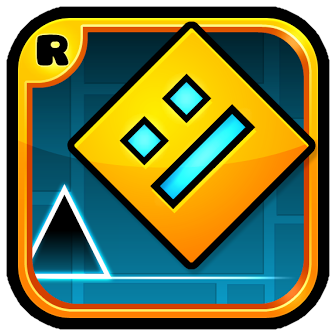

# Blockwork for Geometry Dash

A [Geode](https://geode-sdk.org) mod that runs and records [Blockwork](https://github.com/Blockworked/Blockwork) macros inside Geometry Dash, synced to level attempts. Blockwork's engine (`blockwork-ffi`, a static library built from the Blockwork repo) is linked into the mod, so the desktop app doesn't need to be running.



## Layout

| Path | What it is |
| --- | --- |
| `src/main.cpp` | Settings, hotkeys, attempt start/end, frame-locked playback and step recording, and the game hooks (`$modify`) |
| `src/MacrosPopup.*` | The in-game panel for choosing, creating and clearing macros |
| `src/LevelMacros.hpp` | Which macro belongs to which level, kept in the mod's saved values |
| `mod.json` | Mod metadata and every setting shown in Geode's settings page |
| `about.md`, `changelog.md` | Text Geode shows on the mod's page |
| `scripts/` | Linux test tools (below) |

## Building

The mod targets Windows Geometry Dash, including under Proton (`resources/linux-input.so` is the Linux-side input helper it starts there). These steps cross-compile the Windows build from Linux. `CMakeLists.txt` also links a macOS build (`blockwork-ffi/build-macos.sh` in Blockwork makes the library), but `just` has no recipe for it.

You need:
- the [Geode CLI and SDK](https://docs.geode-sdk.org/getting-started/), with `GEODE_SDK` set
- a Blockwork checkout, by default next to this one at `../Blockwork`
- an xwin "splat" folder with the Windows SDK, and a clang-cl CMake toolchain file
- `just`, `cmake`, `ninja` and Rust with the `x86_64-pc-windows-msvc` target

Copy `.env.example` to `.env` and fill in the paths, then:

```sh
just build     # builds blockwork-ffi and resources/linux-input.so from the Blockwork checkout, then the mod
just install   # installs the .geode into your Geode profile
just run       # install, then launch the game
just clean
```

To configure CMake by hand, pass `-DBLOCKWORK_FFI_LIB` (the built `blockwork_ffi.lib`) and `-DBLOCKWORK_FFI_INCLUDE_DIR` (`blockwork-ffi/include` in the Blockwork repo).

The release workflow (`.github/workflows/multi-platform.yml`, run by hand with a version) does not build `blockwork-ffi` yet, so CI builds stop at CMake's `BLOCKWORK_FFI_LIB` check. Release builds currently come from `just build`.

## Testing

The scripts assume Linux, Steam and Proton, and the Python ones use `evdev` for a virtual keyboard.

- `scripts/autotest.py [--level ID] [--macro ID] [--runs N]` launches the game, opens a level with a macro running frame-locked, and reports the outcome from the Geode log. It turns QOL mod's safe mode on and disables timing mods for the run (restored afterwards), and overwrites this mod's own settings. `GD_DIR`, `GD_MOD_SAVES` and `BLOCKWORK_DIR` override the Steam, save and Blockwork config paths. Its defaults name a local level ("Bloodbath 2") and macro ("Bloodbath (frame-locked)"); pass `--local ""` and `--source` to use others.
- `scripts/inputgen.py MACRO_JSON` presses Space on a macro's schedule, paced by the step counter the mod writes to `/tmp/bw_step.txt`.
- `scripts/strayinput.py [SECONDS]` presses Space at random, to check that playback ignores real input.
